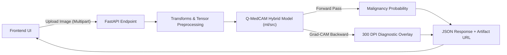

# Q-MedCAM: Backend Service

This directory is designated for the fullstack application's backend API.

## Planned Stack
- **Framework:** FastAPI (Python 3.12)
- **ASGI Server:** Uvicorn
- **Quantum Engine:** IBM Qiskit + Qiskit Machine Learning
- **Deep Learning:** PyTorch (Inference Engine)
- **Validation:** Pydantic v2

## Planned Endpoints
- `GET /health` - Service health status and GPU/Quantum backend availability.
- `POST /api/v1/predict` - Upload a dermoscopic lesion image and receive binary classification ($p(\text{malignant})$), risk classification, and confidence.
- `POST /api/v1/explain` - Execute end-to-end Grad-CAM backward propagation across the quantum-classical boundary and return a 300 DPI composite overlay and raw heatmap coordinates.
- `GET /api/v1/metrics` - Model benchmark metrics and validation scorecard.

## Architecture

